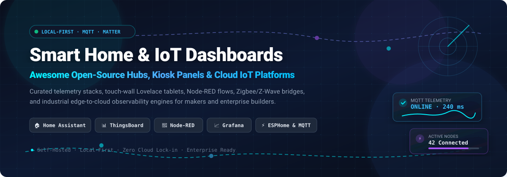

# 🏡 Awesome Smart Home & IoT Dashboards

<p align="center">
  
</p>

<p align="center">
  <a href="https://github.com/ishandutta2007/Awesome-Awesome-Awesome"></a>
  <a href="https://discord.gg/jc4xtF58Ve"></a>
  <a href="https://github.com/ishandutta2007/Awesome-Smart-Home-IOT-Dashboards/stargazers"></a>
  <a href="https://github.com/ishandutta2007/Awesome-Smart-Home-IOT-Dashboards/network/members"></a>
  <a href="https://github.com/ishandutta2007/Awesome-Smart-Home-IOT-Dashboards/issues"></a>
  <a href="https://github.com/ishandutta2007/Awesome-Smart-Home-IOT-Dashboards/blob/main/LICENSE"></a>
  <a href="https://github.com/ishandutta2007"></a>
</p>

---

## ⚡ Top Smart Home & IoT Dashboards Ecosystem

> **Curated List of SaaS/Hosted Platforms & Open-Source GitHub Projects for Smart Home Automation, Kiosk Displays, Wall Tablets, Local-First IoT Telemetry, and Industrial Observability.**

Whether you are building a touch-friendly wall-mounted smart tablet, deploying an industrial energy management console, monitoring private environmental sensors over MQTT, or orchestrating Matter/Zigbee/Thread devices, having the right dashboard and visualization platform is essential. This repository tracks both prominent hosted SaaS solutions and extensible open-source projects.

---

## 📑 Table of Contents

- [🌐 Sector Overview & Market Dynamics](#-sector-overview--market-dynamics)
- [☁️ SaaS & Hosted Platforms](#️-saas--hosted-platforms)
- [💻 Open-Source GitHub Projects](#-open-source-github-projects)
- [🛠️ Recommended Architecture & Frameworks](#️-recommended-architecture--frameworks)
- [🤝 How to Contribute](#-how-to-contribute)
- [⭐ Star History](#-star-history)
- [💖 Support & Sponsorship](#-support--sponsorship)
- [⚖️ Disclaimer](#️-disclaimer)

---

## 🌐 Sector Overview & Market Dynamics

The global smart home and IoT management software market is estimated at **$162 billion to $230 billion** (projected to reach **$450+ billion to $900+ billion by the mid-2030s** at a **CAGR of 11.8% – 23.1%**). 

The sector is **moderately fragmented**: major cloud-first tech giants (Amazon, Google, Apple, Samsung) compete for mass-market consumer device control, while commercial IoT PaaS providers (Tuya, Particle, ThingsBoard) dominate OEM hardware fleets, and an increasingly influential open-source/local-first ecosystem (Home Assistant, Grafana, openHAB) captures privacy-conscious makers and enterprise home-labbers demanding zero cloud dependency and vendor neutrality.

---

## ☁️ SaaS & Hosted Platforms

Below is a detailed comparison of popular SaaS and cloud-hosted IoT dashboard platforms. Entries are sorted descending by company size (valuation / enterprise scale / annual revenue).

| 🏢 Platform | 📝 Overview & Core Features | 💰 Pricing (Starting Paid Tier) | 🎁 Free Tier / Free Trial Limits | 📊 Company Size (Valuation / Revenue) |
| :--- | :--- | :--- | :--- | :--- |
| **[Tuya Developer Platform](https://tuya.com)** | 🌐 Global IoT PaaS and smart home cloud powering OEM hardware, white-label apps, MQTT/Matter device control, and web management consoles. | **$5,000 / year** (~$416/mo) for Standard Commercial Edition | **Trial Edition (Free for 1 year)**: Up to 50 cloud devices (max 10 controllable devices), 26,000 API calls/month, 68,000 message pushes/month. | **$1.26 Billion Market Cap** (~$322M Annual Revenue, NYSE: TUYA) |
| **[Arduino Cloud](https://arduino.cc)** | 📟 Integrated web IDE, device manager, and custom dashboard builder for ESP32, ESP8266, and Arduino microcontrollers with OTA sketch updates. | **$3.99 / month** (or $32.40/yr billed annually) for Entry Plan | **Free Plan forever**: Up to 2 "Things" (devices), 5 variables per Thing, 1-day historical data retention, 25 compilations/day. | **~$140M – $250M Estimated Revenue** (Backed by Qualcomm, Arm, Renesas, Bosch) |
| **[Particle Cloud](https://particle.io)** | 📡 Edge-to-cloud IoT device management platform featuring cellular/Wi-Fi fleet provisioning, telemetry dashboards, logic engines, and OTA updates. | **$299 / month** (Basic Plan, 1 block) | **Free Plan forever**: Up to 100 devices (Wi-Fi/Ethernet/Cellular), 100,000 Data Operations/month, 100 MB pooled cellular data. | **~$200 Million Valuation** (~$20M ARR; acquired by Digi International) |
| **[Losant](https://losant.com)** | 🏭 Enterprise IoT application enablement platform offering digital twins, drag-and-drop workflow engines, edge compute, and custom customer dashboards. | **$250 / month** (Launch Plan for entry deployments) | **Developer Sandbox (Free forever)**: Up to 10 devices, 30 days data retention, full access to workflows & dashboards (or 60-day full Enterprise Trial). | **~$25M – $50M Valuation** (~$25M raised; acquired by SUSE) |
| **[Adafruit IO](https://io.adafruit.com)** | 🍓 Maker-centric cloud data logging and dashboard builder supporting MQTT/REST feeds, visual widgets, triggers, and CircuitPython/WipperSnapper. | **$10 / month** (or $99/year) for Adafruit IO+ | **Free Plan forever**: Up to 10 data feeds, 30 data points per minute, 30 days of data storage, 5 dashboards, 2 WipperSnapper devices. | **~$25M – $50M Annual Revenue** (Bootstrapped, 100% private & debt-free) |
| **[Home Assistant Cloud (Nabu Casa)](https://nabucasa.com)** | 🏠 Zero-configuration remote access relay, Alexa & Google Assistant voice integrations, WebRTC camera relay, and cloud TTS/STT for Home Assistant. | **$6.50 / month** (or $65/year billed annually) | **31-Day Free Trial**: Full unrestricted access to encrypted remote URL, Alexa/Google Home voice bridges, and Assist TTS/STT without credit card. | **~$10M – $15M Estimated ARR** (Bootstrapped; directly funds Open Home Foundation) |
| **[ThingsBoard Cloud](https://thingsboard.io)** | 📊 Fully-managed enterprise multi-tenant IoT cloud platform for real-time telemetry analytics, interactive dashboards, alarms, and rule chains. | **$49 / month** (Prototype Tier for up to 50 devices & 10M data pts/mo) | **Free Plan forever**: Up to 5 devices, 5 assets, 1 million data points/month, 5 dashboards, 3 rule chains, 2 customers, community support. | **~$4.6M – $9M Estimated Revenue** (Bootstrapped profitable COSS leader) |
| **[Blynk](https://blynk.io)** | 📱 Low-code IoT cloud suite featuring mobile apps and web dashboard drag-and-drop designers, device provisioning, and automated firmware updates. | **$29 / month** (Starter Plan for up to 10 devices) | **Free Plan forever**: Up to 5 connected devices, 1 user, 100,000 messages/month, 1 week of historical data retention. | **~$3.7M Estimated ARR** (Raised ~$2.2M venture funding) |
| **[Ubidots](https://ubidots.com)** | 📈 Low-code IoT application platform for system integrators and OEMs to design sensor dashboards, synthetic variables, scheduled reports, and alerts. | **$99 / month** (Professional Plan for up to 50 devices & 10M dots/mo) | **STEM Tier (Free for personal use)**: Up to 3 devices, 10 variables/device, 4,000 dots/day ingestion, 1 dashboard with 10 widgets (or 30-day commercial trial). | **~$2M – $4M Estimated Revenue** (Raised $430K Seed; 35+ team members) |
| **[Datacake](https://datacake.co)** | 🍰 Low-code multi-protocol IoT platform featuring one-click LoRaWAN network server integrations, cellular decoders, and customizable public/private dashboards. | **€25 / month** (~$27/mo) (Hobby Plan for up to 25 devices) | **Free Plan forever**: Up to 5 devices, 500 data points/day, 7 days time-series data retention, full access to dashboard builder & LoRaWAN LNS. | **~$1M Estimated ARR** (Raised €1.2M seed backing from Cantaloupe & Predli) |

---

## 💻 Open-Source GitHub Projects

Explore the leading self-hosted, open-source smart home dashboards, visualization engines, and home automation platforms. Sorted descending by GitHub stargazers count.

| 📦 Repository & Project | ⭐ Stars | 📋 Description & Capabilities | 🔗 Direct Links |
| :--- | :---: | :--- | :--- |
| **[Home Assistant](https://github.com/home-assistant/core)** | [](https://github.com/home-assistant/core/stargazers) | The world's leading open-source home automation hub. Features the modular Lovelace dashboard engine, 3,000+ device integrations, native Matter/Thread/Zigbee support, and local voice assist. | [GitHub](https://github.com/home-assistant/core) • [Website](https://www.home-assistant.io) |
| **[Grafana](https://github.com/grafana/grafana)** | [](https://github.com/grafana/grafana/stargazers) | Industry-standard observability platform. Commonly paired with InfluxDB, Prometheus, or TimescaleDB to create high-density smart home energy monitoring and sensor telemetry dashboards. | [GitHub](https://github.com/grafana/grafana) • [Website](https://grafana.com) |
| **[Frigate NVR](https://github.com/blakeblackshear/frigate)** | [](https://github.com/blakeblackshear/frigate/stargazers) | Open-source local AI Network Video Recorder (NVR) with real-time person/vehicle/pet detection via Coral TPU, low-latency go2rtc WebRTC camera feeds, and embedded Home Assistant cards. | [GitHub](https://github.com/blakeblackshear/frigate) • [Website](https://frigate.video) |
| **[Homepage](https://github.com/gethomepage/homepage)** | [](https://github.com/gethomepage/homepage/stargazers) | Highly customizable, secure, and blazing-fast home-lab service dashboard with built-in status widgets for Home Assistant, Pi-hole, AdGuard, Proxmox, and environmental sensors. | [GitHub](https://github.com/gethomepage/homepage) • [Website](https://gethomepage.dev) |
| **[InfluxDB](https://github.com/influxdata/influxdb)** | [](https://github.com/influxdata/influxdb/stargazers) | Purpose-built time-series database engine with integrated dashboard visualization tooling for collecting millions of sensor metrics, electricity counters, and weather stations. | [GitHub](https://github.com/influxdata/influxdb) • [Website](https://www.influxdata.com) |
| **[Tasmota](https://github.com/arendst/Tasmota)** | [](https://github.com/arendst/Tasmota/stargazers) | Alternative open-source firmware for ESP8266 and ESP32 devices providing an embedded web dashboard, local timers, and MQTT control for smart sockets, relays, and sensors without vendor cloud. | [GitHub](https://github.com/arendst/Tasmota) • [Website](https://tasmota.github.io/docs/) |
| **[MagicMirror²](https://github.com/MagicMirrorOrg/MagicMirror)** | [](https://github.com/MagicMirrorOrg/MagicMirror/stargazers) | Modular smart mirror and ambient display platform with hundreds of community modules for calendars, public transit, weather, indoor air quality, and Home Assistant entity controls. | [GitHub](https://github.com/MagicMirrorOrg/MagicMirror) • [Website](https://magicmirror.builders) |
| **[Node-RED](https://github.com/node-red/node-red)** | [](https://github.com/node-red/node-red/stargazers) | Low-code, flow-based visual programming environment for connecting physical I/O pins, MQTT brokers, REST APIs, and smart home hubs with real-time logic pipelines. | [GitHub](https://github.com/node-red/node-red) • [Website](https://nodered.org) |
| **[ThingsBoard Community Edition](https://github.com/thingsboard/thingsboard)** | [](https://github.com/thingsboard/thingsboard/stargazers) | Open-source enterprise IoT platform for telemetry collection, rule chains, device management, geographic maps, and customizable drag-and-drop dashboard widgets. | [GitHub](https://github.com/thingsboard/thingsboard) • [Website](https://thingsboard.io) |
| **[WLED](https://github.com/wled/WLED)** | [](https://github.com/wled/WLED/stargazers) | Fast and feature-rich implementation of an ESP8266/ESP32 web server to control NeoPixel (WS2812B, SK6812) LED strips with a responsive web dashboard, UI presets, and MQTT/Home Assistant sync. | [GitHub](https://github.com/wled/WLED) • [Website](https://kno.wled.ge) |
| **[EMQX](https://github.com/emqx/emqx)** | [](https://github.com/emqx/emqx/stargazers) | Ultra-scalable distributed open-source MQTT message broker featuring a rich built-in web management dashboard, metrics visualization, and real-time rule engine. | [GitHub](https://github.com/emqx/emqx) • [Website](https://www.emqx.com) |
| **[Zigbee2MQTT](https://github.com/Koenkk/zigbee2mqtt)** | [](https://github.com/Koenkk/zigbee2mqtt/stargazers) | Bridges Zigbee smart home devices directly to MQTT networks. Includes an intuitive built-in web frontend for network topology maps, OTA firmware updates, and reporting parameters. | [GitHub](https://github.com/Koenkk/zigbee2mqtt) • [Website](https://www.zigbee2mqtt.io) |
| **[ESPHome](https://github.com/esphome/esphome)** | [](https://github.com/esphome/esphome/stargazers) | System to control ESP8266/ESP32/RP2040 microcontrollers through simple YAML configuration files with native Home Assistant integration and local web dashboard interfaces. | [GitHub](https://github.com/esphome/esphome) • [Website](https://esphome.io) |
| **[Eclipse Mosquitto](https://github.com/eclipse-mosquitto/mosquitto)** | [](https://github.com/eclipse-mosquitto/mosquitto/stargazers) | Lightweight, C-based open-source MQTT message broker that serves as the central communication backbone for thousands of local IoT sensors and smart home dashboards. | [GitHub](https://github.com/eclipse-mosquitto/mosquitto) • [Website](https://mosquitto.org) |
| **[OpenTelemetry Collector](https://github.com/open-telemetry/opentelemetry-collector)** | [](https://github.com/open-telemetry/opentelemetry-collector/stargazers) | Vendor-agnostic proxy to receive, process, and export telemetry data (metrics, logs, traces) from edge nodes and IoT gateways to monitoring dashboards. | [GitHub](https://github.com/open-telemetry/opentelemetry-collector) • [Website](https://opentelemetry.io) |
| **[evcc](https://github.com/evcc-io/evcc)** | [](https://github.com/evcc-io/evcc/stargazers) | Solar/PV electric vehicle charging controller with a modern, responsive web dashboard for tracking home energy production, grid feed-in, battery storage, and dynamic power tariffs. | [GitHub](https://github.com/evcc-io/evcc) • [Website](https://evcc.io) |
| **[Freeboard](https://github.com/Freeboard/freeboard)** | [](https://github.com/Freeboard/freeboard/stargazers) | Lightweight real-time HTML5/JSON/WebSocket/MQTT client dashboard builder for embedding quick telemetry visualization widgets in static websites and dashboards. | [GitHub](https://github.com/Freeboard/freeboard) • [Website](http://freeboard.io) |
| **[Homarr](https://github.com/homarr-labs/homarr)** | [](https://github.com/homarr-labs/homarr/stargazers) | Sleek, modern self-hosted home-lab dashboard integrating with smart home systems, network appliances, and media servers with customizable widget boards. | [GitHub](https://github.com/homarr-labs/homarr) • [Website](https://homarr.dev) |
| **[Mushroom Cards](https://github.com/piitaya/lovelace-mushroom)** | [](https://github.com/piitaya/lovelace-mushroom/stargazers) | Minimalist, touch-friendly UI card suite that completely modernizes Home Assistant wall tablet interfaces with rounded aesthetics and clean entity badges. | [GitHub](https://github.com/piitaya/lovelace-mushroom) • [Docs](https://github.com/piitaya/lovelace-mushroom) |
| **[Bubble Card](https://github.com/Clooos/Bubble-Card)** | [](https://github.com/Clooos/Bubble-Card/stargazers) | Ultra-smooth, customizable pop-up cards and slider interfaces for Home Assistant touch screens and mobile kiosks with native haptic feel. | [GitHub](https://github.com/Clooos/Bubble-Card) • [Docs](https://github.com/Clooos/Bubble-Card) |
| **[LocalTuya](https://github.com/rospogrigio/localtuya)** | [](https://github.com/rospogrigio/localtuya/stargazers) | Custom Home Assistant integration that enables direct local LAN polling and control of Tuya Wi-Fi smart devices without sending data to the Tuya cloud. | [GitHub](https://github.com/rospogrigio/localtuya) • [Docs](https://github.com/rospogrigio/localtuya) |
| **[Domoticz](https://github.com/domoticz/domoticz)** | [](https://github.com/domoticz/domoticz/stargazers) | Lightweight, C++ home automation system engineered to run with ultra-low memory footprints on Raspberry Pi boards with built-in interactive floorplan dashboards. | [GitHub](https://github.com/domoticz/domoticz) • [Website](https://www.domoticz.com) |
| **[Gladys Assistant](https://github.com/GladysAssistant/Gladys)** | [](https://github.com/GladysAssistant/Gladys/stargazers) | Privacy-oriented, Node.js & Preact smart home server with an elegant zero-YAML touch dashboard designed for easy setup on Raspberry Pi and NAS hardware. | [GitHub](https://github.com/GladysAssistant/Gladys) • [Website](https://gladysassistant.com) |
| **[openHAB](https://github.com/openhab/openhab-core)** | [](https://github.com/openhab/openhab-core/stargazers) | Enterprise-grade Java smart home platform with semantic device modeling, MainUI, and the HABPanel kiosk dashboard builder designed for tablet kiosks. | [GitHub](https://github.com/openhab/openhab-core) • [Website](https://www.openhab.org) |
| **[openHASP](https://github.com/HASwitchPlate/openHASP)** | [](https://github.com/HASwitchPlate/openHASP/stargazers) | Open-source firmware for cheap ESP32 touchscreen panels (e.g., Sunton, WT32-SC01) driving LVGL touch menus controlled entirely via MQTT and Home Assistant. | [GitHub](https://github.com/HASwitchPlate/openHASP) • [Website](https://openhasp.com) |
| **[FlowFuse Dashboard 2.0](https://github.com/FlowFuse/node-red-dashboard)** | [](https://github.com/FlowFuse/node-red-dashboard/stargazers) | Modern Vue-based visual dashboard generator for Node-RED flows, enabling drag-and-drop gauges, charts, tables, and buttons for IoT telemetry. | [GitHub](https://github.com/FlowFuse/node-red-dashboard) • [Website](https://dashboard.flowfuse.com) |
| **[ioBroker Controller](https://github.com/ioBroker/ioBroker.js-controller)** | [](https://github.com/ioBroker/ioBroker.js-controller/stargazers) | Core daemon for ioBroker, a modular Node.js home automation platform with the popular `vis` WYSIWYG graphical dashboard editor and 500+ device adapters. | [GitHub](https://github.com/ioBroker/ioBroker.js-controller) • [Website](https://www.iobroker.net) |
| **[HABirdDashboard](https://github.com/adamoberley/habirddashboard)** | [](https://github.com/adamoberley/habirddashboard/stargazers) | Clean, wall-mounted tablet kiosk dashboard designed for Home Assistant users, focusing on high visibility, rapid state updates, and clean aesthetic cards. | [GitHub](https://github.com/adamoberley/habirddashboard) • [Docs](https://github.com/adamoberley/habirddashboard) |

---

## 🛠️ Recommended Architecture & Frameworks

To assemble a resilient, privacy-first, local-control home dashboard stack:

```
┌─────────────────────────────────────────────────────────────┐
│                 WALL TABLET / KIOSK DISPLAY                 │
│        (Mushroom Cards / Bubble Card / HABirdDashboard)      │
└──────────────────────────────┬──────────────────────────────┘
                               │ WebSocket / REST API
┌──────────────────────────────▼──────────────────────────────┐
│                    HOME ASSISTANT CORE                      │
│            (State Engine, Automations, Lovelace)            │
└──────────────┬──────────────────────────────┬───────────────┘
               │ MQTT                          │ Long-Term Data
┌──────────────▼──────────────┐ ┌─────────────▼──────────────┐
│       ECLIPSE MOSQUITTO     │ │    INFLUXDB + GRAFANA      │
│     (Local MQTT Broker)     │ │  (Telemetry & Analytics)   │
└──────┬───────────────┬──────┘ └────────────────────────────┘
       │               │
┌──────▼──────┐ ┌──────▼──────┐
│ ZIGBEE2MQTT │ │   ESPHOME   │
│  (Zigbee)   │ │ (ESP32/8266)│
└─────────────┘ └─────────────┘
```

1. **Local Control & Protocol Bridges**: Run **Zigbee2MQTT** and **ESPHome** communicating over a local **Eclipse Mosquitto** or **EMQX** broker.
2. **Central Automation Engine**: Connect all entities into **Home Assistant** or **openHAB** for offline rule evaluation.
3. **Kiosk & Wall Panels**: Deploy **Mushroom Cards**, **Bubble Card**, or **openHASP** hardware touchscreens for responsive wall-mounted controls.
4. **Historical Telemetry**: Stream sensor metrics to **InfluxDB** and render long-term environmental trends with **Grafana**.

---

## 🤝 How to Contribute

1. Fork the repository on GitHub.
2. Add your SaaS or open-source IoT dashboard platform to the appropriate table in `README.md`.
3. Provide exact pricing, verified free tier limits, company valuation/revenue data, and official repository links.
4. Submit a Pull Request with a clear description of why the project belongs in this curated list.

---

## ⭐ Star History

[](https://star-history.com#ishandutta2007/Awesome-Smart-Home-IOT-Dashboards&type=date&legend=top-left)

---

## 💖 Support & Sponsorship

Thank you for visiting and using this curated directory! If you found this list helpful for building your smart home or IoT dashboard project, please consider:

- ⭐ **Starring** the repository on GitHub to help others discover it.
- 🍴 **Forking** and contributing new tools, widgets, and integrations.
- 📢 **Sharing** this repository with fellow home-labbers, makers, and IoT developers.
- ☕ **Buying a coffee & sponsoring ongoing maintenance**: Visit the [GitHub Sponsor Dashboard](https://github.com/sponsors/ishandutta2007) to support continuous updates!

---

## ⚖️ Disclaimer

- This is a community-curated collection intended for educational and reference purposes. It does not constitute commercial endorsement.
- Smart home dashboards interact with real-world physical hardware (relays, switches, locks, cameras, and heaters). Always isolate IoT devices on a dedicated VLAN with restricted WAN access.
- Secure remote dashboard endpoints using WireGuard, Tailscale, or strong multi-factor authentication (2FA). Never expose unauthenticated dashboard ports to the public internet.

---

<p align="center">
  <b>Built with ❤️ for smart home builders, embedded engineers, and open-source home-lab enthusiasts.</b>
</p>
